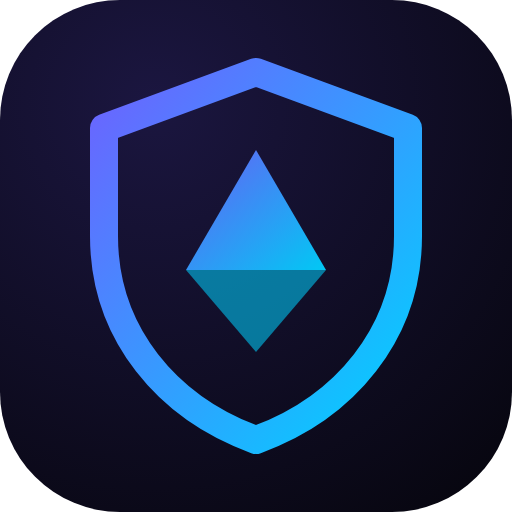
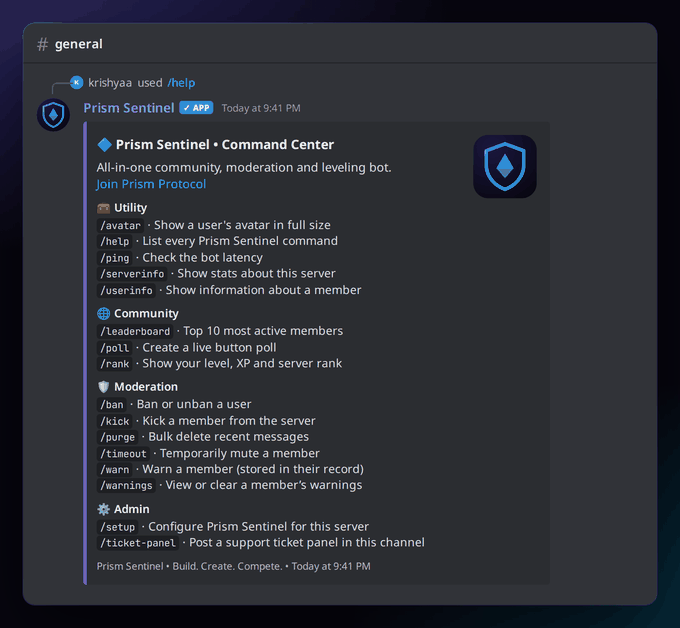
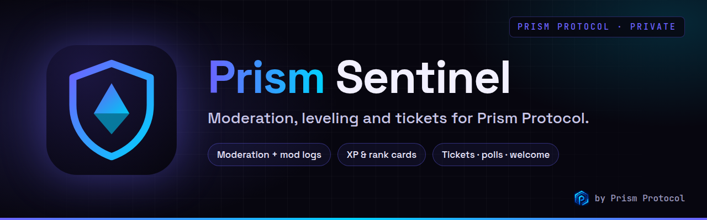
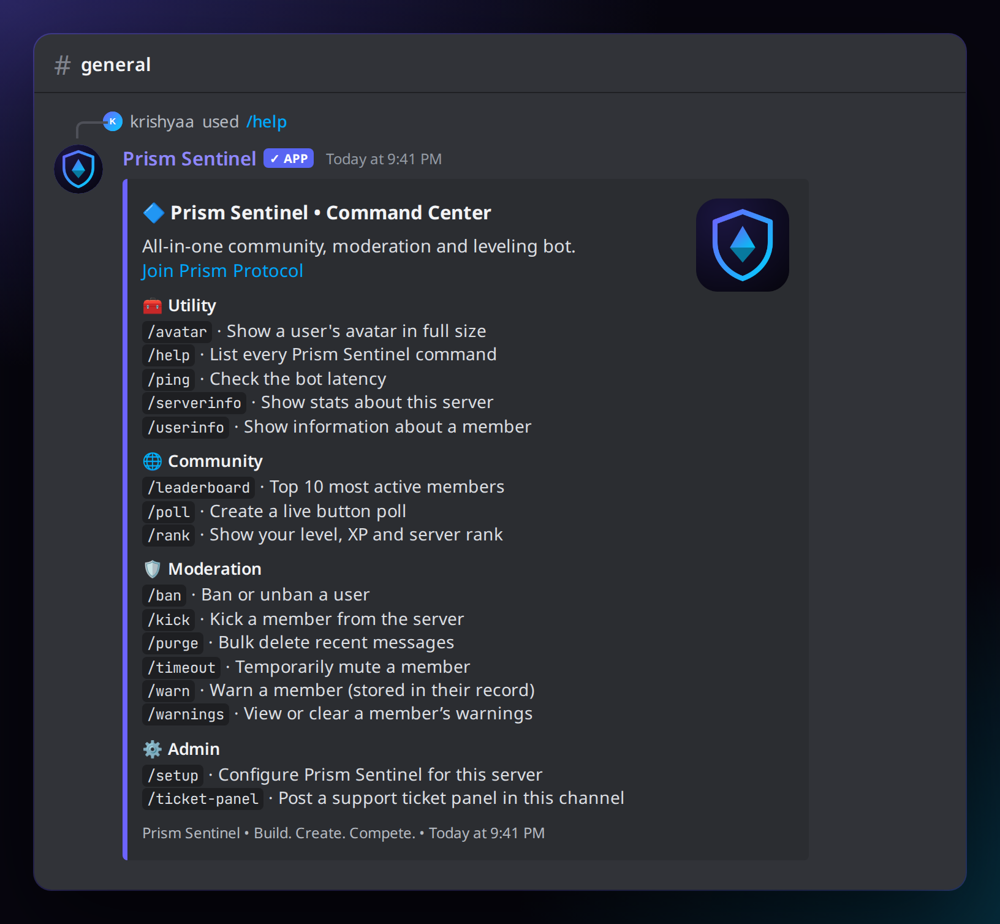
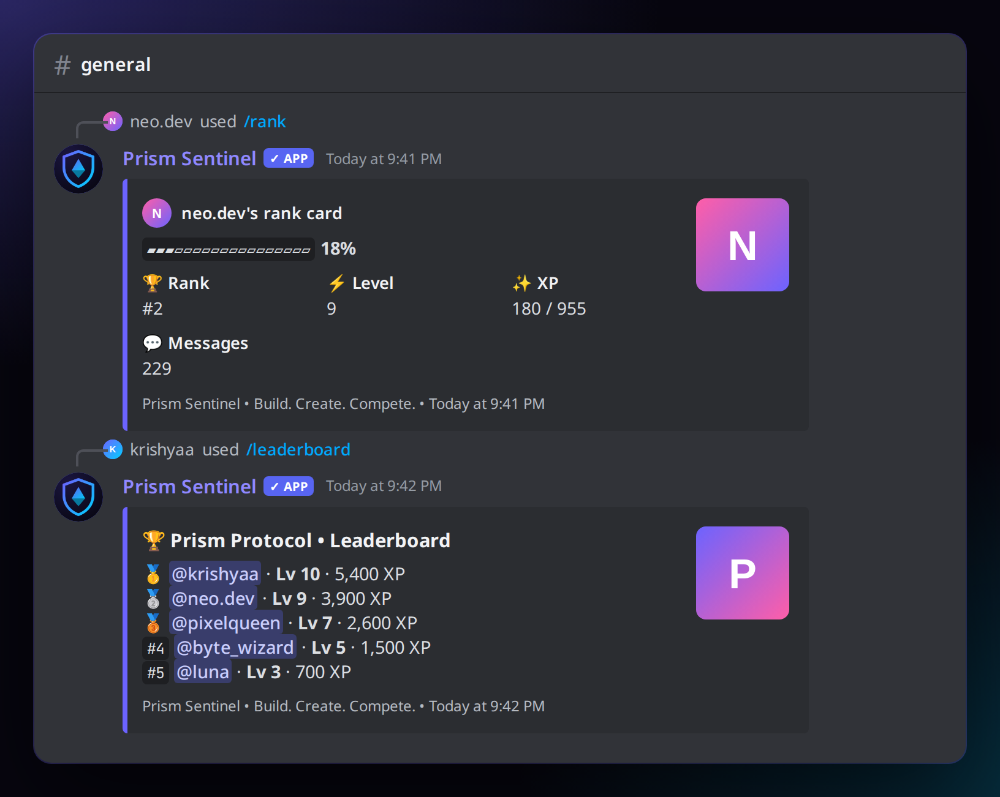
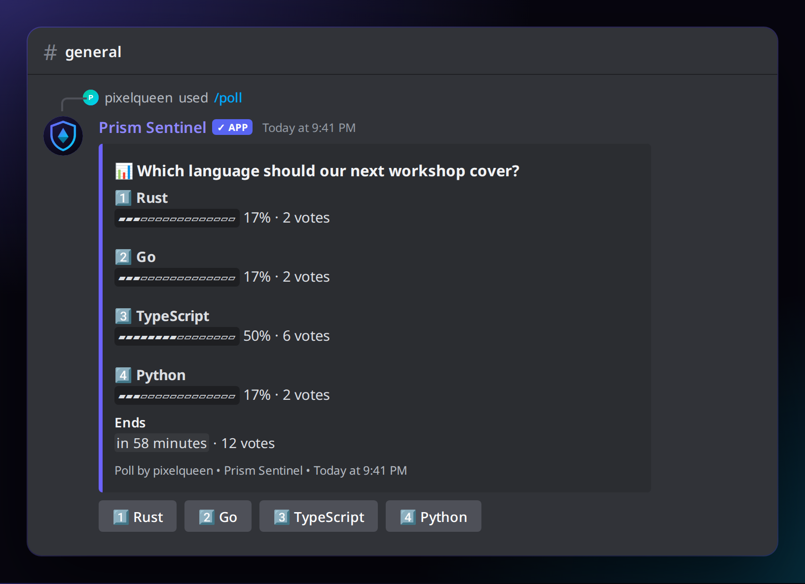
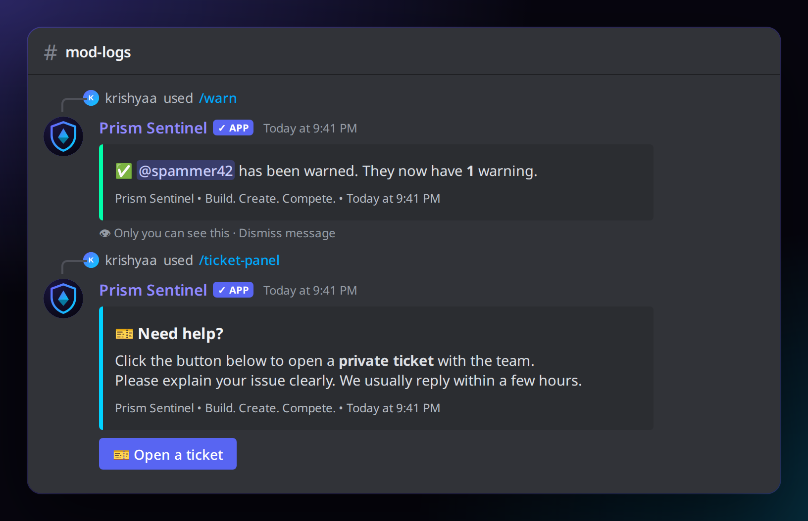
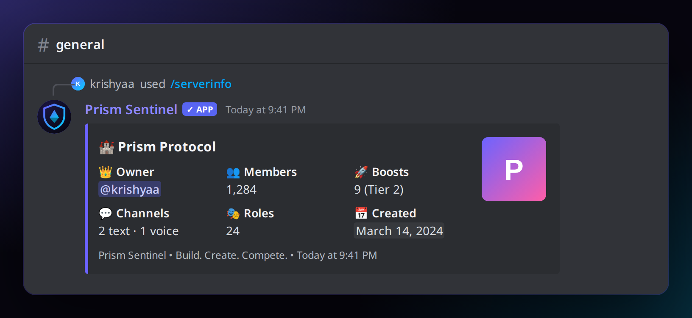
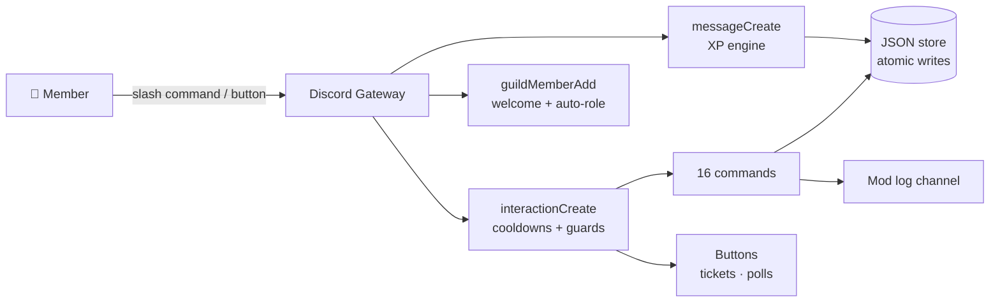

<!-- ═════════════ HEADER ═════════════ -->
<p align="center">
  
</p>

<p align="center">
  
</p>

<p align="center">
  
</p>

<p align="center">
  
  
  
  <a href="LICENSE"></a>
  
</p>

<p align="center">
  
</p>

<p align="center">
  
</p>

<p align="center">
  <a href="https://krishyaa06.github.io/prism-bots-panel/#/dashboard/sentinel"></a>
  <a href="https://dc.gg/prismprotocol"></a>
</p>


## ⚡ Overview

> [!NOTE]
> **Private bot for the [Prism Protocol](https://dc.gg/prismprotocol) server.** Prism Sentinel is not listed for public invites. The code is open so you can learn from it or self-host your own copy. Join the community to see it live, or open its page on the [Prism Bots Panel](https://krishyaa06.github.io/prism-bots-panel/#/bot/sentinel).

**Prism Sentinel** is the community bot built for the [Prism Protocol](https://dc.gg/prismprotocol) Discord server.
It replaces three or four separate bots with one clean, fast and self-hosted package: **leveling, moderation, tickets, polls and welcome messages**, all with beautiful branded embeds and modern slash commands.

- 🧠 **No database to install**: data is stored in small JSON files with atomic writes
- 🛡️ **Safe by default**: role-hierarchy checks, permission guards and per-command cooldowns
- 🎨 **On-brand**: every embed uses the Prism colour palette (configurable)
- 🧪 **Tested**: unit tests for the XP curve, storage and helpers, plus a command self-check

## 📸 Screenshots

<table>
  <tr>
    <td width="50%"><p align="center"><b>/help</b> · Command center</p></td>
    <td width="50%"><p align="center"><b>/rank</b> + <b>/leaderboard</b> · XP & levels</p></td>
  </tr>
  <tr>
    <td width="50%"><p align="center"><b>/poll</b> · Live button voting</p></td>
    <td width="50%"><p align="center"><b>/warn</b> + <b>/ticket-panel</b> · Moderation & support</p></td>
  </tr>
</table>

<p align="center"><br><sub><b>/serverinfo</b> · Server stats at a glance</sub></p>

## ✨ Features

| Module | What it does |
|--------|--------------|
| ⚡ **Leveling** | 15 to 25 XP per message (1 reward per minute, short spam ignored), level-up announcements, `/rank` cards and a top-10 `/leaderboard` |
| 🛡️ **Moderation** | `/warn` with stored history, `/timeout` (`10m`, `2h`, `1d`…), `/kick`, `/ban add/remove`, `/purge` up to 100 messages (optionally by user) |
| 📜 **Mod logs** | Every action is posted to a log channel with moderator, target, reason and timestamp |
| 🎫 **Tickets** | One-click private support channels visible only to the member and your support role, with a close button |
| 📊 **Polls** | 2 to 5 options, up to 7 days, live progress bars, click again to remove your vote, auto-closes on time |
| 👋 **Welcome** | Custom welcome message with `{user}` `{username}` `{server}` `{count}` placeholders plus an optional auto-role |
| 🔄 **Presence** | Rotating status every 30 seconds |
| 🧰 **Utility** | `/ping`, `/serverinfo`, `/userinfo`, `/avatar` |

## 🧩 Commands

| Command | Description | Required permission |
|---------|-------------|:-------------------:|
| `/help` | List every command | Everyone |
| `/ping` | Check the bot latency | Everyone |
| `/serverinfo` | Owner, members, boosts, channels, roles | Everyone |
| `/userinfo [user]` | Account age, join date, roles | Everyone |
| `/avatar [user]` | Show a user's avatar in full size | Everyone |
| `/rank [user]` | Level, XP progress bar, rank and messages | Everyone |
| `/leaderboard` | Top 10 most active members | Everyone |
| `/poll question options [minutes]` | Button poll, options separated by `\|` | Everyone |
| `/warn user reason` | Warn a member and store it | Moderate Members |
| `/warnings view\|clear user` | See or reset someone's warnings | Moderate Members |
| `/timeout user duration [reason]` | Mute for up to 28 days (`0m` removes it) | Moderate Members |
| `/kick user [reason]` | Kick a member | Kick Members |
| `/ban add\|remove` | Ban (with message cleanup) or unban by ID | Ban Members |
| `/purge amount [user]` | Bulk delete 1 to 100 recent messages | Manage Messages |
| `/setup welcome\|logs\|autorole\|levelup\|view` | Configure the bot for your server | Manage Server |
| `/ticket-panel [support_role] [category] [title] [description]` | Post the "Open a ticket" panel | Manage Server |

## 🚀 Getting Started

### 1. Create the bot

1. Open the [Discord Developer Portal](https://discord.com/developers/applications) → **New Application**
2. **Bot** tab → **Reset Token** → copy it (keep it secret)
3. On the same page enable these **Privileged Gateway Intents**:
   - ✅ **Server Members Intent** (welcome messages and auto-role)
   - ✅ **Message Content Intent** (XP spam filter)
4. Copy the **Application ID** from **General Information**

### 2. Install

```bash
git clone https://github.com/krishyaa06/prism-sentinel.git
cd prism-sentinel
npm install
cp .env.example .env      # then paste your token and application ID
```

| Variable | Required | Description |
|----------|:--------:|-------------|
| `DISCORD_TOKEN` | ✅ | Bot token from the Developer Portal |
| `CLIENT_ID` | ✅ | Application ID |
| `GUILD_ID` | | Register commands instantly in one test server (leave empty for global) |
| `EMBED_COLOR` | | Brand colour in hex, default `6C63FF` |
| `SENTINEL_DATA_DIR` | | Where JSON data is stored, default `./data` |

### 3. Invite it to your server

Replace `YOUR_CLIENT_ID` and open the link:

```
https://discord.com/oauth2/authorize?client_id=YOUR_CLIENT_ID&permissions=1099780156438&scope=bot%20applications.commands
```

This grants only what the bot needs: View Channels, Send Messages, Embed Links, Read History, Manage Messages, Manage Channels, Manage Roles, Kick, Ban and Timeout Members.

> 💡 Drag the **Prism Sentinel** role above the roles it should manage (auto-role, moderation targets).

### 4. Run

```bash
npm run check     # validates every command definition
npm run deploy    # registers slash commands
npm start         # starts the bot
```

Then in Discord run `/setup logs`, `/setup welcome` and `/ticket-panel` to finish the setup.

## 🌐 Web dashboard

Prism Sentinel has a built-in API for the [Prism Bots Panel](https://krishyaa06.github.io/prism-bots-panel/#/dashboard/sentinel), so staff can change settings and see live stats from the browser.

1. Set `PANEL_API_PORT=8080` (any free port) in `.env` and restart the bot. `PANEL_ORIGIN` defaults to `https://krishyaa06.github.io`.
2. Expose it over HTTPS, e.g. Caddy `sentinel.example.com { reverse_proxy localhost:8080 }` or a Cloudflare Tunnel.
3. In the panel repo, set `bots.sentinel.apiUrl` in `js/config.js` to that URL.

Login uses Discord OAuth2 (`identify guilds`). Every request is checked for **Manage Server** in that guild.

## 🎨 Branding

| File | Use |
| --- | --- |
| `assets/logo.svg` / `assets/logo.png` | Logo |
| `assets/banner.png` | README / social preview (1280×400) |
| `assets/discord/avatar.png` | Discord avatar / app icon (1024×1024) |
| `assets/discord/profile-banner.png` | Discord profile banner (1360×480) |

## 🏗️ Architecture



## 📁 Project Structure

```
prism-sentinel/
├── src/
│   ├── commands/
│   │   ├── admin/        # setup, ticket-panel
│   │   ├── community/    # rank, leaderboard, poll
│   │   ├── moderation/   # warn, warnings, timeout, kick, ban, purge
│   │   └── utility/      # help, ping, serverinfo, userinfo, avatar
│   ├── events/           # ready, interactionCreate, messageCreate, guildMemberAdd
│   ├── lib/              # panelApi + panelAdapter (web dashboard), db, embeds, levels, modlog, tickets, polls, guards, loader, logger
│   ├── config.js
│   ├── deploy-commands.js
│   └── index.js
├── scripts/check.js      # offline validation of all commands
├── test/                 # node:test unit tests
├── data/                 # JSON data (git-ignored)
└── assets/               # logo + screenshots
```

## 🧪 Testing

```bash
npm test          # XP curve, level-ups, storage and helpers
npm run check     # loads every command and validates it without logging in
```

## ☁️ Hosting

Any always-on Node.js host works: a VPS, Railway, Render (background worker), Fly.io or a Raspberry Pi.
Keep the `data/` folder on persistent storage, or set `SENTINEL_DATA_DIR` to a mounted volume.

```bash
# example with pm2
npm i -g pm2 && pm2 start src/index.js --name prism-sentinel && pm2 save
```

## 🗺️ Roadmap

- [x] Leveling, leaderboard and rank cards
- [x] Warn / timeout / kick / ban / purge with mod logs
- [x] Ticket system and live polls
- [x] Welcome messages and auto-role
- [ ] Level role rewards
- [ ] Auto-moderation (links, caps, mass mentions)
- [ ] Web dashboard
- [ ] Image rank cards

## 🤝 Contributing

1. Fork the repo
2. Create a branch: `git checkout -b feature/amazing-idea`
3. Run `npm test && npm run check`
4. Commit, push and open a Pull Request

New commands only need a file in `src/commands/<category>/`. The loader picks them up automatically.

## 👤 Author

<table>
  <tr>
    <td align="center">
      <a href="https://github.com/krishyaa06"><br><b>Soumya Bhandare</b></a><br>
      <sub>Founder @ Prism Protocol</sub>
    </td>
    <td>
      <a href="https://dc.gg/prismprotocol"></a><br>
      <a href="https://instagram.com/prism_protocol_"></a><br>
      <a href="https://x.com/krishyaa06"></a>
    </td>
  </tr>
</table>

## 📄 License

Released under the [MIT License](LICENSE).

<p align="center">
  <b>If you like this project, consider giving it a ⭐</b><br>
  <sub>"Build. Create. Compete." · Made with ⚡ by Prism Protocol</sub>
</p>


